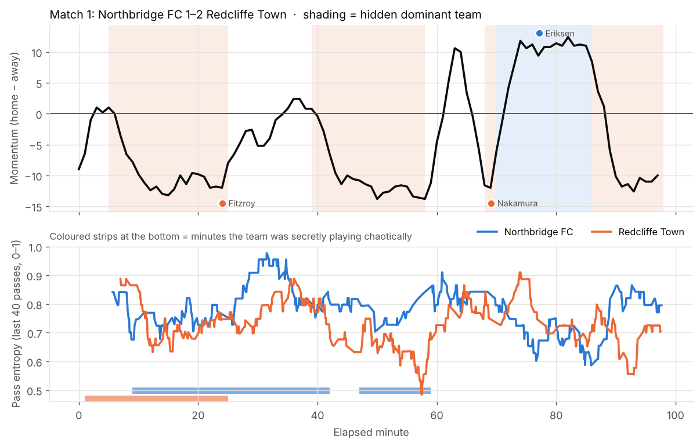
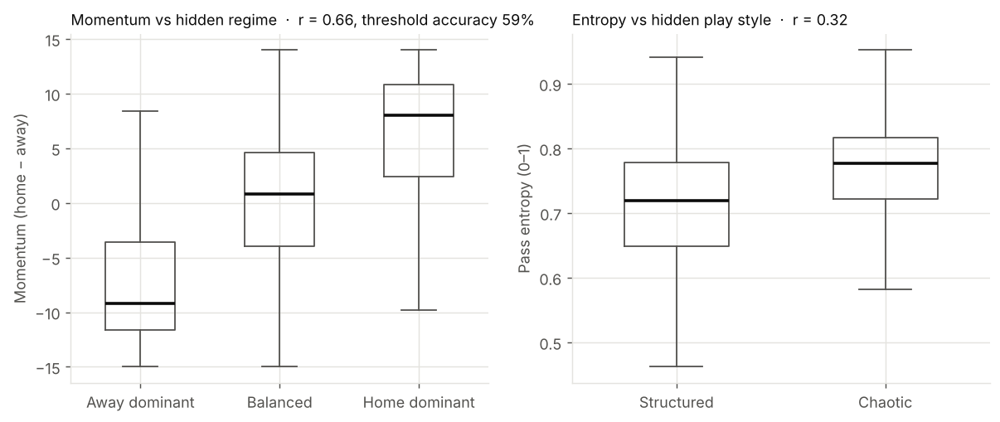
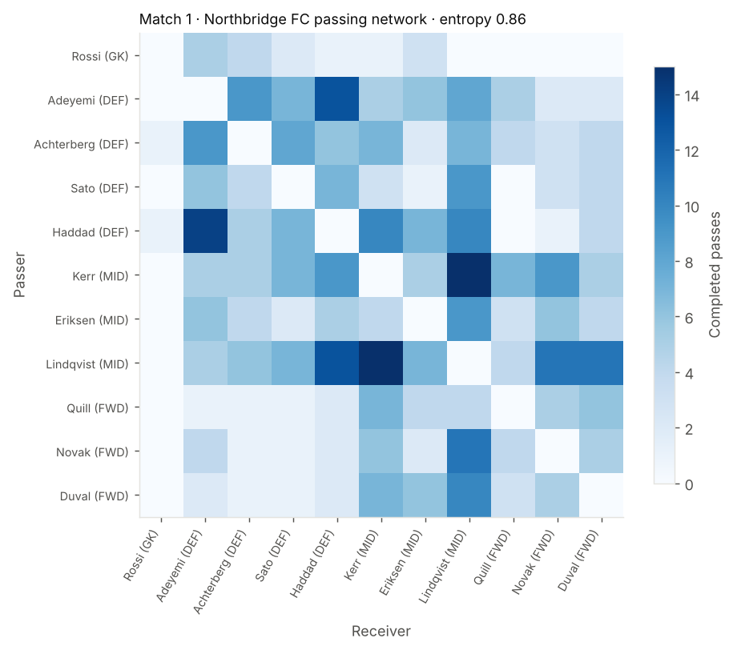

# Momentum & Chaos Engine

**Every app tells you who has momentum. We tell you what kind.**

A live engine for the Premier League × Microsoft hackathon. It reads synthetic football events as they happen and
tells viewers two things, minute by minute:

1. **Momentum:** which team is on top right now, and when that flipped.
2. **What kind of momentum:** is the team dominating through *control* (organized, low-entropy passing) or through
   *chaos* (unpredictable, high-entropy passing)?

Key moments are turned into short AI-written insights, written differently for a casual fan and a data-hungry analyst.

---

## Contents

- [Status](#status)
- [Quick start](#quick-start)
- [Project structure](#project-structure)
- [The data](#the-data)
- [The hidden truth: what it is and how it is defined](#the-hidden-truth-what-it-is-and-how-it-is-defined)
- [The metrics](#the-metrics)
- [Results so far](#results-so-far)
- [How it maps to the hackathon brief](#how-it-maps-to-the-hackathon-brief)
- [Roadmap](#roadmap)
- [Working together](#working-together)
- [Known limitations](#known-limitations)
- [References](#references)

---

## Status

| Component | File | Owner | Status |
| --- | --- | --- | --- |
| Synthetic match generator | `src/generate_matches.py` | A | ✅ Done |
| Offline analysis + validation | `src/analyze_data.py` | A | ✅ Done |
| Live event streamer | `src/streamer.py` | A | ⬜ Next |
| Incremental metrics engine (momentum, entropy, states, key moments) | `src/metrics.py` | A | ⬜ Next |
| AI narration (Azure OpenAI, casual / analyst, languages) | `src/narrator.py` | B | ⬜ Next |
| Dashboard (Streamlit) | `src/app.py` | B | ⬜ Later |

---

## Quick start

You need **Python 3.10+**. In VS Code, install the **Python** extension, then **File → Open Folder…** and open
this repo.

```bash
# 1. Create a virtual environment and install the libraries (once)
python -m venv .venv
source .venv/bin/activate          # Windows: .venv\Scripts\activate
pip install -r requirements.txt

# 2. Generate 10 synthetic matches into data/
python src/generate_matches.py --matches 10 --seed 42 --out data

# 3. Analyse them: summary table + plots into figures/
python src/analyze_data.py --data data --match 1 --out figures
```

Options:

| Script | Option | Default | Meaning |
| --- | --- | --- | --- |
| `generate_matches.py` | `--matches` | 10 | How many matches to simulate |
| | `--seed` | 42 | Random seed. Same seed = identical data, so we can both reproduce results |
| | `--out` | `data` | Output folder |
| `analyze_data.py` | `--data` | `data` | Folder made by the generator |
| | `--match` | 1 | Which match to plot in detail |
| | `--out` | `figures` | Output folder |

`data/` and `figures/` are not committed to git: anyone can recreate them in a few seconds with the commands above.

---

## Project structure

```
momentum-engine/
├── src/
│   ├── generate_matches.py   # simulates matches, writes data/
│   └── analyze_data.py       # metrics, plots and validation, writes figures/
├── docs/img/                 # example figures used in this README
├── notebooks/                # exploration only; finished code moves to src/
├── requirements.txt
└── README.md
```

---

## The data

The hackathon requires **synthetic** data, so we generate our own. Each match is simulated **event by event**: the
ball moves from player to player, gets pressed, tackled, intercepted and shot, with realistic timing. Players and
clubs are invented.

### Typical match

| Measure | Value per match (approx.) |
| --- | --- |
| Events | ~2,200 |
| Passes | ~1,400 (77% completed) |
| Shots | ~28 |
| Goals | ~3.4 |
| Length | ~97 minutes including stoppage time |

### Files written to `data/`

| File | One row per | Key columns | Can the engine read it? |
| --- | --- | --- | --- |
| `events.csv` | event | see below | ✅ Yes, this is the live feed |
| `players.csv` | player per match | `player_id`, `player_name`, `position`, `team` | ✅ Yes |
| `matches.csv` | match | clubs, final score | ✅ Yes |
| `truth_regimes.csv` | minute per match | `regime`, `label`, `home_chaotic`, `away_chaotic` | ❌ **Validation only** |
| `truth_hot_streaks.csv` | team per match | hot player, `start_minute`, `end_minute` | ❌ **Validation only** |
| `truth_team_styles.csv` | team per match | `style_alpha` | ❌ **Validation only** |

### `events.csv` columns

| Column | Meaning |
| --- | --- |
| `match_id`, `event_id` | Identifiers. `event_id` is the order events happen in |
| `period` | 1 = first half, 2 = second half |
| `minute`, `second` | Match clock (second half starts at 45:00) |
| `timestamp_s` | **Stream time:** seconds since kickoff, continuous, half-time skipped. Use this for live streaming and to join with the truth files |
| `team`, `team_name` | `home` / `away` and the club name |
| `player_id`, `player_name`, `position` | Who performed the event (GK / DEF / MID / FWD) |
| `event_type` | `pass`, `pressure`, `tackle`, `interception`, `shot` |
| `outcome` | pass: `complete` / `incomplete` · tackle: `won` / `lost` · interception: `won` · pressure: `applied` · shot: `goal` / `saved` / `off_target` / `blocked` |
| `x`, `y` | Where it happened, **in the acting team's attacking direction**: x = 0 own goal line, x = 100 opponent goal line; y = 0–100 across the pitch |
| `end_x`, `end_y` | Where a pass was aimed (passes only) |
| `receiver_id`, `receiver_name` | Intended receiver (passes only). This is what the entropy is built from |
| `xg` | Expected-goals value of a shot (shots only) |
| `under_pressure` | Whether the pass was made under a pressing action |
| `home_score`, `away_score` | Score after this event |

The event logic in brief: each step, the team in possession either **shoots** (only in the final quarter of the
pitch), gets **tackled** (about 10% of steps), or **passes**, sometimes under **pressure**. A failed pass becomes an
**interception** for the other team. Who receives a pass depends on position (forwards get the ball more in the
final third) and on each team's passing habits.

---

## The hidden truth: what it is and how it is defined

### Why we need it

With real match data, nobody can tell you who *really* had momentum: that is exactly the thing we are trying to
measure. Synthetic data lets us do something real data can't: **we decide the answer in advance, hide it, and check
whether our engine finds it.**

So the generator has hidden "dials" that change how teams play. They are never written into `events.csv`; they only
**change the probabilities** of what happens. The engine sees only the events, exactly as it would with a real feed.
The dials are saved separately in the `truth_*.csv` files, and we use them only to grade the engine.

> **Rule:** the engine (`streamer.py`, `metrics.py`, `narrator.py`, `app.py`) must never read a `truth_*.csv` file.
> Only validation code may.

There are four hidden layers.

### 1. Momentum regime: who is dominating (`truth_regimes.csv` → `regime`, `label`)

**What it is:** a single match-level state with three values:

| `regime` | `label` | Meaning |
| --- | --- | --- |
| +1 | `home_dominant` | Home team is on top |
| 0 | `balanced` | Neither team is on top |
| −1 | `away_dominant` | Away team is on top |

**How it changes:**
- Every match starts `balanced`.
- Every minute of stream time, there is a **7% chance** it switches, to one of the other two states at random.
  On average a state lasts about 14 minutes.
- After a goal, there is a **40% chance** momentum swings to the team that just conceded (the "response" after
  going behind).
- In practice: about 8 switches per match, and roughly a third of minutes in each state.

**What it does to play:** the code uses `d` = +1 when the team on the ball is the dominant one, −1 when it is the
dominated one, and 0 when balanced. `d` then shifts five probabilities:

| Effect | Formula in the code | Dominant (d = +1) | Balanced (d = 0) | Dominated (d = −1) |
| --- | --- | --- | --- | --- |
| Pass completion | base 0.85 + 0.05·d | 0.90 | 0.85 | 0.80 |
| How far forward passes go (mean, pitch %) | 5 + 4·d | 9 | 5 | 1 |
| Chance of being pressed before a pass | 0.22 − 0.08·d | 14% | 22% | 30% |
| Chance the opponent's tackle succeeds | 0.45 − 0.10·d | 35% | 45% | 55% |
| Base shot chance per action in the final quarter | 0.024 + 0.010·d (+ more closer to goal) | 3.4% | 2.4% | 1.4% |

None of these is dramatic on its own. Together, a dominant team progresses further, keeps the ball longer, wins it
back higher and shoots more, which is what momentum looks like on the pitch.

### 2. Play style: structured vs chaotic (`truth_regimes.csv` → `home_chaotic`, `away_chaotic`)

**What it is:** a separate switch **per team**: 0 = structured, 1 = chaotic.

**How it changes:**
- Both teams start structured.
- Every minute, each team independently has a **5% chance** to flip (about 20 minutes per spell on average).
- It is **independent of momentum**. That is deliberate: it means all four quadrants of our match-state map can
  occur (controlled dominance, chaotic pressure, being read, scrambling), so we can test that the engine tells
  them apart.
- In practice each team is chaotic about half the time.

**What it does to play when chaotic:**

| Effect | Structured | Chaotic |
| --- | --- | --- |
| Choice of receiver | Follows the team's passing habits (`habit` = 1.0) | Habits flattened (`habit` = 0.2): the ball goes to a wider spread of teammates |
| Spread of pass length (forward / sideways) | 9 / 15 | 13 / 20 |
| Pass completion | — | 4 points lower |

The first row is what entropy should pick up: when a team's passes are spread more evenly across passer–receiver
pairs, their passing is less predictable, so its entropy rises.

### 3. Hot streak: a player "on a roll" (`truth_hot_streaks.csv`)

**What it is:** one hidden hot streak per team per match.

**How it is defined:**
- One **outfield** player is chosen at random.
- The streak starts at a random time between **minute 10 and 75** and lasts **8–15 minutes**.

**What it does during the streak:**
- Teammates pass to this player **twice as often** (more involvement).
- Their own passes are **8 points more likely** to be completed.
- Their shots have **20% higher xG** (better chances).

This is the ground truth for the stretch-goal "player on a roll" feature.

### 4. Team passing style (`truth_team_styles.csv` → `style_alpha`)

**What it is:** each team's fixed passing habits for the whole match.

**How it is defined:** each player gets a share of the team's passing preferences, drawn from a Dirichlet
distribution with concentration `style_alpha`, which is drawn between **0.3 and 3.0**:
- **Low alpha** (e.g. 0.4): passes concentrate on a few key players (a playmaker-centric team) → **lower entropy**.
- **High alpha** (e.g. 2.8): passes spread evenly across the team → **higher entropy**.

This mirrors the between-team differences that Neuman et al. (2018) measured across a Premier League season.

### Other built-in effects (not in the truth files)

These make the data realistic but are not things we try to detect:
- **Fatigue:** after minute 55, pass completion drops by 0.15 points per minute (about 6 points by minute 95).
- **Position:** forwards receive more passes in the final third; defenders and goalkeepers more in their own third.
- **Final-third difficulty:** passes into the final third are 8 points less likely to be completed.
- **Shot quality:** xG falls with distance to goal (about 0.22 from 11 m, 0.06 from 20 m).

### Time base: important when joining files

The truth is recorded per **elapsed minute of stream time** (`timestamp_s // 60`), which runs continuously through
both halves with half-time skipped. It is **not** the `minute` column (the match clock, which restarts at 45:00).
Always join on:

```python
events["elapsed_minute"] = (events.timestamp_s // 60).astype(int)
```

---

## The metrics

These are implemented in `src/analyze_data.py` and will move into `src/metrics.py` for the live engine.

### Momentum

Each event earns "threat points" for the team that made it:

| Event | Points |
| --- | --- |
| Completed pass ending in the final third (`end_x` ≥ 66) | 1 |
| Ball won (tackle or interception) in the opponent's half (`x` ≥ 50) | 2 |
| Shot | 3 |

Momentum = (home points − away points) per minute, averaged over the **last 5 minutes**. Positive = home on top,
negative = away on top.

### Pass entropy

For each team, take its **last 40 completed passes**, count how often each passer→receiver pair occurs, and compute
the **Tsallis entropy** with q = 0.2 (the same measure as Neuman et al., 2018):

```
S_q = (1 − Σ pᵢ^q) / (q − 1)
```

where pᵢ is the share of passes going through pair i. It is scaled to 0–1 by dividing by the maximum possible value
(every pass a different pair). Low = predictable, concentrated passing; high = spread out, harder to predict.

Relative entropy (team minus opponent) is the planned "control vs chaos" axis.

### Match state (planned)

Combining the two gives four states:

| | Lower entropy than opponent | Higher entropy than opponent |
| --- | --- | --- |
| **Winning momentum** | Controlled dominance | Chaotic pressure |
| **Losing momentum** | Being read | Scrambling |

---

## Results so far

Seed 42, 10 matches:

| Check | Result | Verdict |
| --- | --- | --- |
| Momentum vs hidden regime (correlation) | r = 0.66 | ✅ Clearly detectable |
| Momentum, simple ±2 threshold, regime correctly classified | 59% of minutes (chance = 33%) | ✅ Works, threshold not yet tuned |
| Rolling entropy vs hidden chaotic play | r = 0.32 | ⚠️ Detectable but noisy |
| Whole-match entropy vs hidden passing style | r = 0.31 | ⚠️ Weak |

Numbers vary with the seed (another run gave 0.77 for momentum and 0.41 for entropy), so compare methods over several
seeds.

**Momentum tracks the hidden regime.** Background shading = the hidden dominant team; the black line = our momentum.
Bottom panel: each team's rolling pass entropy; strips = minutes the team was secretly playing chaotically.



**Validation across all 10 matches:**



**Passing network** (the matrix the entropy is computed from):



**What to improve next:** entropy is the weak link. Ideas: compare each team to its own match baseline instead of
an absolute level, try a longer window or smoothing, and tune `q`.

---

## How it maps to the hackathon brief

| Brief stage | Our component |
| --- | --- |
| (a) Ingest events as they happen | `streamer.py` publishes events one at a time (Azure Event Hubs, local queue as fallback) |
| (b) Interpret into stats and patterns | `metrics.py`: momentum, entropy, match state, per-player form |
| (c) Explain why a moment matters | Key moments with their drivers: "control vs chaos", pressure changes, rhythm |
| (d) Render on screen | Streamlit dashboard + timed JSON overlay events |
| (e) Personalize | Casual vs analyst mode, favorite club, favorite player, language |
| (v) Data innovation | This generator, with hidden ground truth for validation |
| (vi) Multi-language | LLM narration in the viewer's language |

---

## Roadmap

| Days | Goal | Person A: data and metrics | Person B: AI and app |
| --- | --- | --- | --- |
| 1–2 | Data | ✅ Generator, ✅ analysis | Repo, Azure, OpenAI access |
| 3–5 | Core engine | Streamer, incremental metrics, key moments | Persona prompts, tested on sample moments |
| 6–8 | Integration | Stream → engine | Streamlit dashboard with live cards |
| 9–10 | Personalization | Full-time recap | Mode, club, language options |
| 11–12 | One stretch goal | Validation plot or player on a roll | |
| 13–14 | Freeze | Bug fixes | Demo video, slides |

---

## Working together

- **Branches:** one branch per feature (`feature/streamer`, `feature/narrator`), merged into `main` via pull requests.
- **Ownership:** Person A owns the streamer and metrics; Person B owns narration and the app. Mostly separate files,
  so merges stay clean.
- **The contract between us:** agree first on the key-moment JSON that `metrics.py` hands to `narrator.py`.
  Draft:

  ```json
  {
    "match_id": 1,
    "elapsed_minute": 63,
    "type": "momentum_shift",
    "team": "away",
    "team_name": "Redcliffe Town",
    "momentum": -8.4,
    "state": "chaotic_pressure",
    "drivers": ["4 high regains in 5 min", "entropy up 0.12 vs opponent"],
    "score": {"home": 1, "away": 1}
  }
  ```
- **Secrets:** Azure keys go in a `.env` file, which is git-ignored. Never commit keys.
- **Notebooks:** fine for exploring in `notebooks/`; once something works, move it into `src/`.

---

## Known limitations

- **Circularity:** the validation only shows that we recover what we built into the generator. It proves the
  pipeline works, not that real football behaves this way. The pipeline is ready to test on real tracking data.
- **Entropy evidence is season-level:** Neuman et al. linked entropy to final league position over a season.
  Nobody has shown it works minute to minute; we present it as "inspired by", not proven.
- **Short windows are noisy:** 40 passes is a small sample, and q = 0.2 amplifies rare passes.
- **Simplified football:** no set pieces, fouls, cards, substitutions or offsides yet.

---

## References

- Neuman, Y., Israeli, N., Vilenchik, D., & Cohen, Y. (2018). The adaptive behavior of a soccer team: An entropy-based
  analysis. *Entropy*, 20(10), 758. https://doi.org/10.3390/e20100758
- Zacks, J. M., Speer, N. K., Swallow, K. M., Braver, T. S., & Reynolds, J. R. (2007). Event perception: A mind–brain
  perspective. *Psychological Bulletin*, 133(2), 273–293.
- Gilovich, T., Vallone, R., & Tversky, A. (1985). The hot hand in basketball. *Cognitive Psychology*, 17(3), 295–314.
- Miller, J. B., & Sanjurjo, A. (2018). Surprised by the gambler's and hot hand fallacies? A truth in small numbers.
  *Econometrica*, 86(6), 2019–2047.
